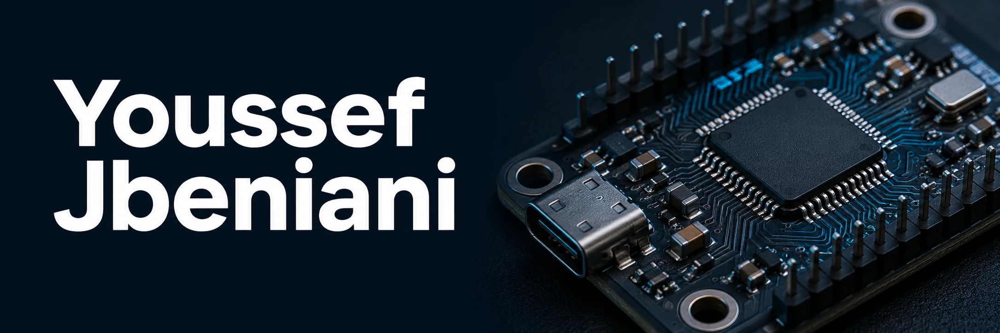
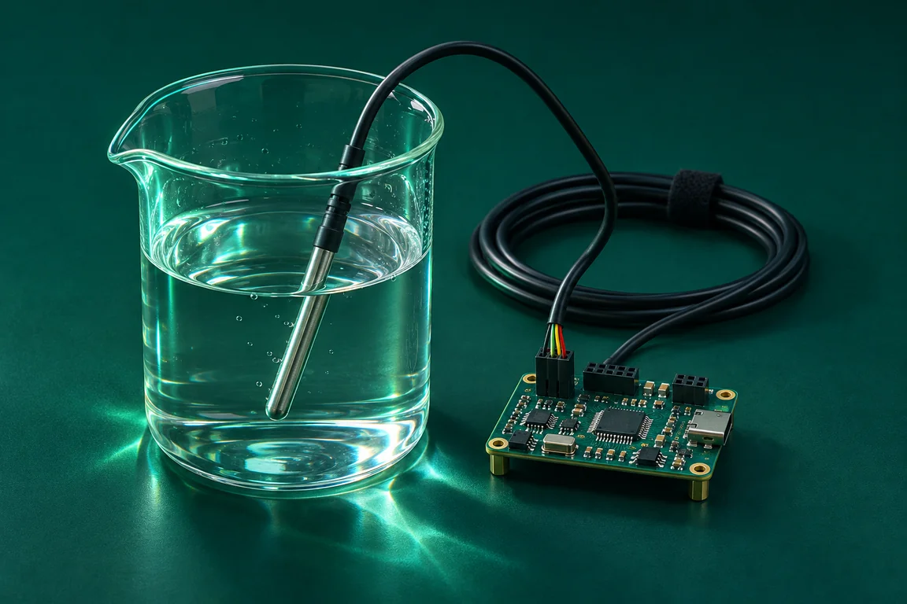
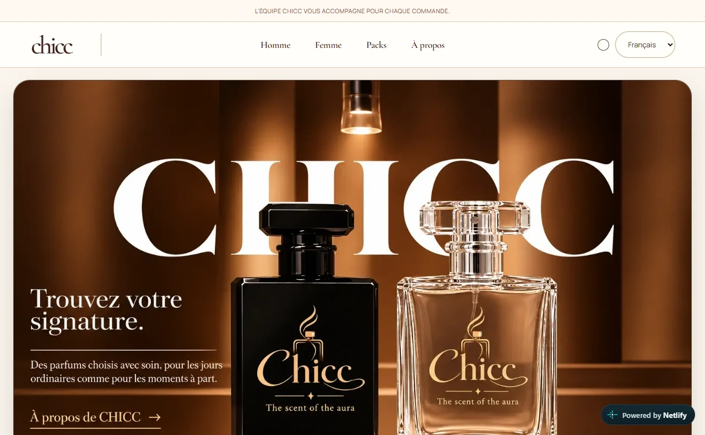

<h1>
  
</h1>

**Final-year Computer Engineering student · Embedded Systems and IoT · Tunisia**

I build connected devices and full-stack applications, from firmware and sensor data to the dashboards people use.

  
  
  

## Selected projects

<table>
  <tr>
    <td width="50%" valign="top">
      
      <h3>DrinkSafe</h3>
      
An ESP32 and React dashboard for water quality readings, trends, alerts, and CSV exports.

      
<code>ESP32</code> <code>ThingSpeak</code> <code>React</code> <code>Express</code> <code>PostgreSQL</code>

      
<a href="https://github.com/youssefjbeniani/DrinkSafe"><strong>DrinkSafe code</strong></a> · <a href="https://youssef-jbeniani-portfolio.vercel.app/projects/drinksafe.html">Project write-up</a>

    </td>
    <td width="50%" valign="top">
      
      <h3>CHICC Commerce</h3>
      
A multilingual fragrance storefront and staff dashboard for catalog management, orders, and delivery tracking.

      
<code>Next.js</code> <code>TypeScript</code> <code>Supabase</code> <code>PostgreSQL</code>

      
<a href="https://github.com/youssefjbeniani/chicc-commerce"><strong>CHICC code</strong></a> · <a href="https://chicc-perfumes.netlify.app/">Live storefront</a>

    </td>
  </tr>
</table>

### [TCP with UPPAAL](https://github.com/youssefjbeniani/TCP-Formal-Verification-UPPAAL)

A timed-automata model of TCP connection setup and teardown, with reachability and deadlock checks and models of SYN flooding and TCP reset scenarios.

`UPPAAL` `Timed automata` `TCP/IP`

### [Pharmacy Management System](https://github.com/youssefjbeniani/Pharmacy-Management-System)

A Java application for sales, stock tracking, and restocking, with separate workflows for pharmacists and managers.

`Java` `SQLite` `JDBC`

## Technical skills

- **Embedded systems and IoT** · Arduino, ESP32, microcontrollers, sensors, MQTT, I²C, SPI, UART, ThingSpeak, Wokwi
- **Programming** · C, C++, Python, Java, JavaScript, TypeScript, PHP, SQL, PL/SQL
- **Web and data** · HTML, CSS, React, Next.js, Node.js, Express, REST APIs, PostgreSQL, MySQL, SQLite, JDBC, Supabase
- **Hardware, networks, and verification** · Computer architecture, digital logic, VHDL, systems on a chip, TCP/IP, routing, switching, Cisco Packet Tracer, UPPAAL, timed automata, model checking
- **Development and deployment** · Git, GitHub, VS Code, Linux, Docker, UML, Netlify

## About

I study Computer Engineering at the Faculty of Sciences of Tunis, specializing in embedded systems and IoT. I’m interested in how firmware, networks, and software work together, and I’m exploring cybersecurity and machine learning.

*Learn. Build. Improve.*
